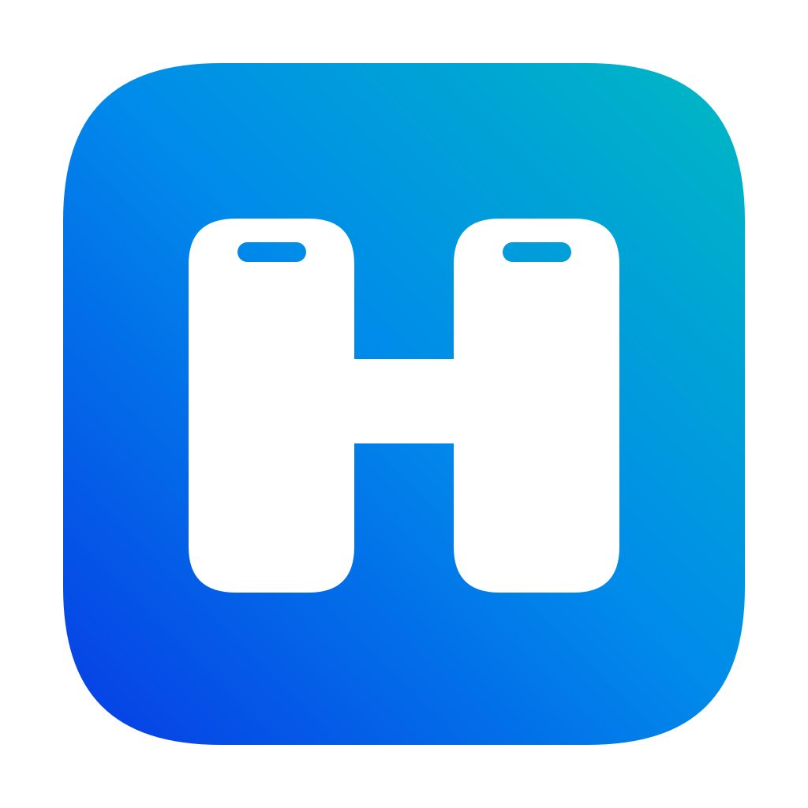

<p align="center">
  
</p>

# Android Hub

A Rust desktop app for managing independent Android devices on macOS Apple Silicon.
Android screens and controls live inside one Hub window, powered by Android Emulator.

**English** · [Tiếng Việt](README.vi.md)

Private repository: **[ducntvt/android-hub](https://github.com/ducntvt/android-hub)**.
Repository access is required to clone or download private releases. Releases provide
source plus an Apple Silicon app ZIP and DMG (macOS 15+), signed ad-hoc and not notarized.

## What it does

- Create Android 12–16 devices with a fixed version, then rename, configure, start, stop or delete them.
- Download selected images and remove unused Hub-managed images with reference checks.
- Control one or two embedded Android screens, with fit/zoom and device selection.
- Use touch/drag, scrolling, keyboard input, Android navigation and rotation.
- Send the macOS clipboard to a selected device and install a single APK.
- Configure CPU, RAM, resolution, orientation and a requested FPS limit.
- Back up stopped devices, restore compatible backups and manage old archives.
- Choose SDK/Java, inspect disk usage and run an on-demand guest connectivity check.
- Switch English/Vietnamese and System/Light/Dark appearance.

Closing Hub normally stops its registered Android engines before exiting. Force
Quit/crashes cannot perform that cleanup. Apps and sign-ins belong to each Android
device; they are not included in this repository.

## Download the app

Open [Releases](https://github.com/ducntvt/android-hub/releases), download the DMG
or `.app.zip`, then copy **Android Hub.app** to Applications. The ZIP contains the
same app as the DMG. `SHA256SUMS` and `INSTALL.txt` accompany each release.
Gatekeeper may block these personal, non-notarized builds; building from source
remains available. SDK/Java/images must be configured separately (see First launch).

## Requirements

| Purpose | Requirements |
| --- | --- |
| Build Hub | macOS on Apple Silicon, Xcode Command Line Tools, Rust/Cargo with rustfmt and Clippy, Python 3.11+ |
| Run Android | Android SDK with Emulator, Platform-Tools, Command-line Tools and a selected Google Play ARM64 Android 12–16 image |
| Create devices | Java 17+ ARM64; Android Studio's bundled JBR is the default |
| Disk space | At least 12 GiB free before creating a device; games and backups require additional space |

The currently verified Rust toolchain is **1.96.1**. It is a reproducible starting
point, not a minimum-supported-Rust claim. Intel Macs, Windows and Linux are not
supported targets. A minimum macOS version has not been validated.

Android SDK/Java are **not required to compile Hub** from its checked-in resources.
They are required for device operations. No SDK or Android system image is bundled.

## Build from source

Install [Rust](https://www.rust-lang.org/tools/install) and Apple's command-line tools
if needed (`xcode-select --install`), then:

```bash
git clone https://github.com/ducntvt/android-hub.git
cd android-hub
rustup toolchain install 1.96.1 --profile minimal --component rustfmt --component clippy
bash scripts/check.sh
bash scripts/build-android-hub.sh
open 'Android Hub.app'
```

Authenticate Git for the private repository first; see [repository access](docs/GITHUB.md).
To reproduce a source release, run `git switch --detach v0.1.0` before building
**only after that tag has been published**. Use `main` until then.

The default build script uses an optimized **development profile**. Use
`bash scripts/package-release.sh` for a release-profile app, ZIP and DMG under
`dist/v<version>-macos-arm64/`. Both paths sign ad-hoc without notarization.
Checks do not boot Android or install SDK packages. Build caches can be removed
after packaging; keep the generated app if you use it.

## First launch

1. Prepare the SDK components listed in [Setup](docs/SETUP.md).
2. In Hub settings, open **SDK setup** and verify your SDK/Java paths.
3. Use **+**, choose Android 12–16 (default 16), then create and start the device.
   If the image is missing, review **Download and create**, its size and license first.
   A device keeps its Android version; create another device to use a different version.
4. Sign in to Google Play directly inside Android when needed.
5. Create a second device and select **2 devices** for concurrent use.

The managed SDK installer is available but its complete fresh-machine install/boot
flow is still being validated. Using an existing compatible SDK is the documented
starting path.

## Your data

Hub stores device disks, registry, preferences, backups and logs directly in:

```text
~/Library/Application Support/Android Hub/
```

This location is independent of the source checkout. `ANDROID_HUB_ROOT` overrides
it for an explicitly isolated QA run. Do not delete app data to troubleshoot SDK
or build problems. Deleting a device requires confirmation and is permanent;
**Back up first** does not automatically proceed to deletion.

## Current limits

- Game compatibility, Play Store availability and FPS depend on the Android image,
  game and host. Selecting 90/120 FPS is a request, not a measured performance guarantee.
- Direct keyboard text input is ASCII; use the explicit clipboard action for Unicode.
- No key mapping, multi-touch, cloning, live VM snapshots or automatic updates.
- Backup/restore requires stopped devices and compatible SDK/image metadata. The
  current restore UI targets a device that is still registered.
- A single APK is supported; XAPK/split APK and an app-update workflow are not.
- Long two-game benchmarks and native accessibility coverage remain incomplete.

## CI and releases

PRs and pushes to `main`/`develop` run the shared checks and app packaging on
macOS ARM64. Rust is pinned in `rust-toolchain.toml`. Pushing a prepared `v*` tag
validates its version, main ancestry and changelog, reruns CI, then publishes a
release with verified app ZIP, DMG, install notes and checksums. See [release preparation](docs/RELEASING.md) before tagging.

## Documentation

- [Setup and troubleshooting](docs/SETUP.md) · [Thiết lập tiếng Việt](docs/SETUP.vi.md)
- [Development and source map](docs/DEVELOPMENT.md)
- [Contribution workflow](CONTRIBUTING.md)
- [Versions, tags and releases](docs/RELEASING.md)
- [Changelog](CHANGELOG.md)
- [Architecture](docs/ARCHITECTURE.md) · [Roadmap](docs/PLAN.md)
- [Third-party notices](THIRD_PARTY_NOTICES.md) · [Security reporting](SECURITY.md)

Architecture decisions and historical implementation evidence may be in Vietnamese.
This private project currently grants no general open-source license; access and
sharing are controlled by the repository owner. Third-party components retain
their own notices and licenses.
