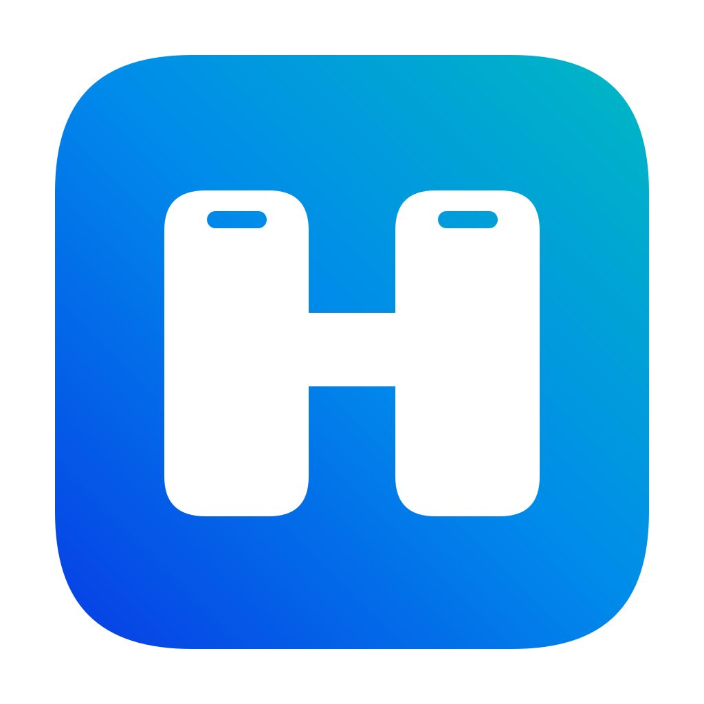

<p align="center">
  
</p>

# Android Hub

Ứng dụng desktop bằng Rust để quản lý các máy Android độc lập trên macOS Apple
Silicon. Màn hình Android và bộ điều khiển nằm trong một cửa sổ Hub, sử dụng
Android Emulator làm engine.

[English](README.md) · **Tiếng Việt**

Repository private: **[ducntvt/android-hub](https://github.com/ducntvt/android-hub)**.
Bạn cần được cấp quyền để clone. Release cung cấp tag source và ghi chú thay đổi;
không có bản app đóng gói sẵn. Người dùng được mời sẽ tự build trên máy của mình.

## Tính năng

- Tạo, đổi tên, cấu hình, khởi động, dừng và xóa máy Android.
- Điều khiển một hoặc hai màn hình Android nhúng, có vừa khung/zoom và chọn máy.
- Chạm, kéo/vuốt, cuộn, bàn phím, navigation Android và xoay thiết bị.
- Gửi clipboard macOS vào đúng máy và cài một file APK.
- Chọn CPU, RAM, độ phân giải, chiều màn hình và giới hạn FPS yêu cầu.
- Sao lưu máy đã dừng, khôi phục backup tương thích và quản lý archive cũ.
- Chọn SDK/Java, xem dung lượng và kiểm tra kết nối trong Android theo yêu cầu.
- Chuyển Anh/Việt và giao diện Theo hệ thống/Sáng/Tối.

Đóng Hub bình thường sẽ dừng các engine Android đã đăng ký trước khi thoát.
Force Quit/crash không chạy được luồng này. App và tài khoản đăng nhập thuộc từng
máy Android; chúng không nằm trong repository.

## Yêu cầu

| Mục đích | Thành phần |
| --- | --- |
| Build Hub | macOS Apple Silicon, Xcode Command Line Tools, Rust/Cargo với rustfmt và Clippy, Python 3.11+ |
| Chạy Android | Android SDK gồm Emulator, Platform-Tools, Command-line Tools và image Google Play ARM64 API 36 |
| Tạo máy | Java 17+ ARM64; mặc định dùng JBR đi kèm Android Studio |
| Dung lượng | Ít nhất 12 GiB trống trước khi tạo máy; game và backup cần thêm dung lượng |

Rust đã được kiểm chứng: **1.96.1**. Đây là mốc để tái lập môi trường, không phải
cam kết phiên bản Rust tối thiểu. Chưa hỗ trợ Mac Intel, Windows hoặc Linux;
chưa xác định phiên bản macOS tối thiểu qua kiểm thử.

**Build Hub không cần SDK/Java** vì các tài nguyên cần thiết đã có trong source.
SDK/Java cần cho thao tác Android. App không đóng gói sẵn SDK hay Android image.

## Build từ source

Cài [Rust](https://www.rust-lang.org/tools/install) và công cụ dòng lệnh Apple nếu
chưa có (`xcode-select --install`), sau đó:

```bash
git clone https://github.com/ducntvt/android-hub.git
cd android-hub
rustup toolchain install 1.96.1 --profile minimal --component rustfmt --component clippy
bash scripts/check.sh
bash scripts/build-android-hub.sh
open 'Android Hub.app'
```

Đăng nhập Git để truy cập repo private trước; xem [hướng dẫn GitHub](docs/GITHUB.md).
Muốn build đúng một bản phát hành, chạy `git switch --detach v0.1.0` trước khi build,
**chỉ khi tag đó đã được phát hành**. Trước đó dùng `main`.

Script đóng gói hiện build **development profile có tối ưu** và ký ad-hoc cho bản
`.app` local; chưa tạo bản phân phối notarized. Bộ kiểm tra không boot Android hay
cài SDK. Sau khi đóng gói có thể dọn target; giữ app nếu đang sử dụng.

## Lần mở đầu tiên

1. Chuẩn bị SDK theo [hướng dẫn thiết lập](docs/SETUP.vi.md).
2. Vào **Cài đặt Hub → Thiết lập SDK**, kiểm tra đường dẫn SDK/Java.
3. Bấm **+** để tạo máy, rồi khởi động.
4. Tự đăng nhập Google Play trong Android khi cần.
5. Tạo máy thứ hai và chọn **2 máy** để sử dụng đồng thời.

Luồng tải SDK trong Hub đã có nhưng vẫn cần kiểm chứng toàn bộ quá trình cài/boot
trên máy sạch. Hướng dẫn hiện ưu tiên dùng SDK tương thích đã cài sẵn.

## Dữ liệu của bạn

Disk máy Android, registry, tùy chọn, backup và log nằm trực tiếp tại:

```text
~/Library/Application Support/Android Hub/
```

Vị trí này độc lập với source. `ANDROID_HUB_ROOT` dùng để chỉ định dữ liệu riêng
cho QA. Không xóa dữ liệu app để sửa lỗi SDK hoặc build. Xóa thiết bị cần xác nhận
và không thể hoàn tác; **Sao lưu trước** không tự chuyển sang bước xóa.

## Giới hạn hiện tại

- Tương thích game, Play Store và FPS phụ thuộc image, game và máy host. Chọn
  90/120 FPS là mức yêu cầu, không phải hiệu năng đã đo được.
- Nhập phím trực tiếp chỉ hỗ trợ ASCII; dùng clipboard cho tiếng Việt/Unicode.
- Chưa có key mapping, đa chạm, clone, snapshot máy đang chạy hoặc auto-update.
- Backup/restore cần máy đã dừng và SDK/image tương thích. UI restore hiện áp dụng
  cho máy vẫn còn trong registry.
- Hỗ trợ một APK; chưa có XAPK/split APK hay luồng cập nhật app đã cài.
- Benchmark hai game dài hạn và native accessibility chưa hoàn tất.

## CI và release source

PR và push vào `main`/`develop` chạy bộ kiểm tra chung và đóng gói app trên
macOS ARM64. Rust được cố định trong `rust-toolchain.toml`. Khi push tag `v*`,
workflow kiểm tra version, commit thuộc lịch sử `main` và changelog, chạy lại CI
rồi tạo release chỉ chứa source. Xem [cách chuẩn bị release](docs/RELEASING.md)
trước khi tạo tag.

## Tài liệu

- [Thiết lập và xử lý lỗi](docs/SETUP.vi.md) · [Setup in English](docs/SETUP.md)
- [Phát triển và cấu trúc source](docs/DEVELOPMENT.md)
- [Quy trình đóng góp](CONTRIBUTING.md)
- [Version, tag và release source](docs/RELEASING.md)
- [Lịch sử thay đổi](CHANGELOG.md)
- [Kiến trúc](docs/ARCHITECTURE.md) · [Kế hoạch](docs/PLAN.md)
- [Thành phần bên thứ ba](THIRD_PARTY_NOTICES.md) · [Báo lỗi bảo mật](SECURITY.md)

Đây là project private, chưa cấp giấy phép open-source chung. Chủ repo quản lý
quyền truy cập/chia sẻ; các thành phần bên thứ ba giữ giấy phép và thông tin nguồn
riêng của chúng.
